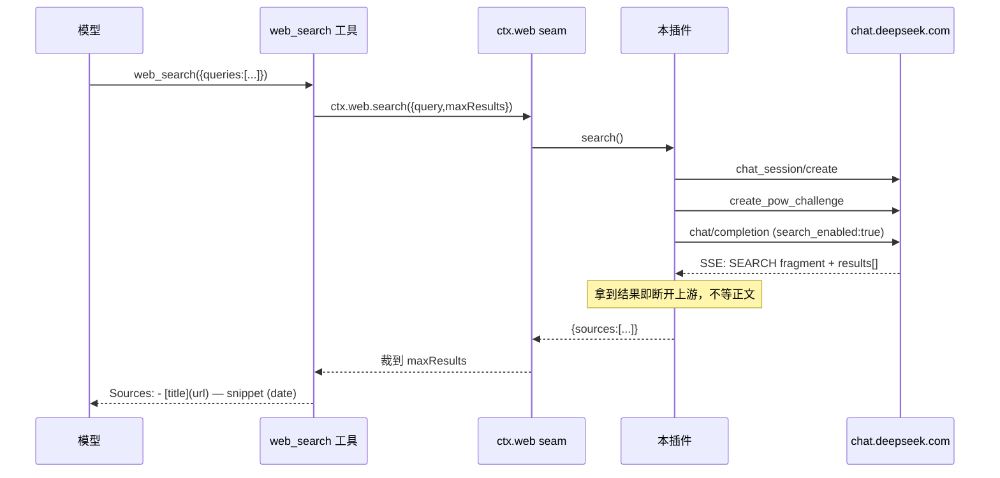

# 架构与实现说明

[← 返回 README](../README.md)

## 1. 为什么是 provider，而不是新工具

DSH 的 web 访问是一道**能力 seam**（`ctx.web`），消费方与提供方彻底分离：

| 角色 | 包 | 本插件的关系 |
|:--|:--|:--|
| 能力 seam | `@deepseek-ai/dsh-web` | `ctx.web.registerSearchProvider(...)` 注册进去 |
| 模型侧工具 | `@deepseek-ai/dsh-tool-web` | **不用改**，它只调 `ctx.web.search()`，不认具体后端 |
| 官方搜索后端 | `@deepseek-ai/dsh-web-search-deepseek` | 被本插件顶替 |
| 代理策略 | `@deepseek-ai/dsh-http-proxy` | 启动器为 `globalThis.fetch` 装全局 dispatcher，我们直接受益 |

provider 契约很小：

```js
{
  id,
  available(): boolean,
  search({ query, maxResults? }, signal): Promise<{ sources, truncated, content? }>
}
```

`sources` 元素为 `{ url, title?, snippet?, publishedAt? }`。`maxResults` 裁剪、多查询去重合并、给模型渲染的文本与系统提示词段落，全部由 DSH 现有组件负责 —— 这也是本插件只有 ~1000 行、能零依赖的原因。

### 必须顶替官方后端

`dsh-base` 的 `cordis.patch.yml` 里：

```yaml
- id: web
  name: '@deepseek-ai/dsh-web'
  config:
    searchProvider: deepseek-official
    fetchProvider: http
```

seam 的选择规则是「配置了 id 就只认这个 id」（`WEB_PROVIDER_CONFIGURED_MISSING` / `…UNAVAILABLE`），因此不覆盖这一项，本插件即使注册成功也永远不会被选中。本插件的 bundle patch 同时做了「钉 id + 挂载自己」两件事。

补丁层应用顺序是 `dsh.profile.bundles`（按顺序）→ profile 的 `cordis.patch.yml`。想换回官方后端，在 profile 层再加一层 `- id: web` 即可。

## 2. 请求链

一次搜索的实际请求与原仓库（Magpie 聊天 provider）同源：

```
解析凭证（每次搜索重新解析，支持热轮换）
  → POST /api/v0/chat_session/create                      开会话，拿 chat_session_id
  → POST /api/v0/chat/create_pow_challenge                拿 DeepSeekHashV1 挑战
  → 解 PoW（23 轮 SHA3 海绵，前缀只吸收一次，逐 nonce 折入）
  → POST /api/v0/chat/completion
       headers: x-ds-pow-response: base64({algorithm, challenge, salt, answer, signature, target_path})
       body:    { action:null, chat_session_id, parent_message_id:null,
                  model_type:"default", prompt, ref_file_ids:[],
                  thinking_enabled:false, search_enabled:true, preempt:false }
  → 解析 SSE 补丁流，只取结构化结果
```

请求头与网页端一致：`authorization: Bearer <userToken>`、`origin`、`referer`、`x-client-platform: web`、`x-client-version`、`x-client-bundle-id: com.deepseek.chat`、`x-client-locale: zh_CN`，以及可选的 `cookie`。

### 时序



## 3. 联网搜索在 SSE 里的形状

网页端不是标准事件流，正文是「补丁」对象。联网搜索的结果落在 fragment 的 `results` 字段上（下例取自实测抓包，`test/fixtures/search-stream.txt` 保留了同样结构）：

```jsonc
// 1) response 对象里回显 search_enabled，并挂一个 type=SEARCH 的 fragment
{"v":{"response":{"search_enabled":true,
  "fragments":[{"type":"SEARCH","status":"WIP","queries":[{"query":"…"}],"results":[]}]}}}

// 2) 结果单独作为补丁落到 fragment 的 results 上（-1 表示「最后一个 fragment」）
{"p":"response/fragments/-1/results","v":[
  {"url":"…","title":"…","snippet":"…","cite_index":1,"published_at":1763308800.0,"site_name":"…"}]}

// 3) 该 fragment 收尾，随后正文 fragment 才开始
{"p":"response/fragments/-1/status","v":"FINISHED"}
{"p":"response/conversation_mode","v":"SEARCH"}
```

补丁还有两种形态，归集器都要认：

```jsonc
// 批量：子路径相对，需与父路径拼接
{"p":"response","o":"BATCH","v":[{"p":"fragments","o":"APPEND","v":[{ /* fragment */ }]}]}

// 仅正文增量
{"v":"油"}
```

`o: "APPEND"` 的 fragment 下标必须**续在已知 fragment 之后**（而不是从 0 开始），否则后到的正文 fragment 会覆盖掉 `SEARCH` 的类型标记，判停逻辑随之失效。这是 `test/sse.test.mjs` 里专门锁住的回归点。

## 4. 两个刻意的设计选择

### 拿到结果就断开上游

网页版在搜索结果之后会接着生成一整轮回答，那部分我们不消费。默认条件是「结果已到手 **且**（正文 fragment 已开始 **或** 上游给出终态）」，此时 `break` 跳出 `for await`，生成器的 `finally` 调 `reader.cancel()` 释放连接 —— 省带宽、省额度，也避免多等几秒生成时间。

之所以要等正文 fragment 开始、而不是结果一到就走：DeepSeek 可能连续搜多轮，太早断开会丢后一轮的来源。

想要完整回答就设 `includeAnswer: true` + `stopAfterResults: false`，回答会作为 `content` 返回。

### 只认结构化字段

绝不从回答正文里正则抓 URL。正文会被改写、翻译、截断，抓出来的「来源」不可信。这与 DSH 官方 provider 的取向一致：宁可明确报错，也不降级成不可信的结果。

同理，没有拿到任何结构化结果时**抛错**（`WEB_PROVIDER_ERROR`，附 `search_enabled` 与 `conversation_mode` 便于定位），而不是返回空列表假装成功。

## 5. 错误与脱敏

`lib/envelope.js` 里的 `SearchError` 是一个与 seam `WebError` **形状兼容**的类（`name` / `code` / `cause`），这样工具侧仍能把失败当作结构化错误呈现。之所以不直接 import 官方的 `WebError`：profile 下的 `node_modules/@deepseek-ai/*` 可能是指向 npx 缓存的 junction，实测 `dsh-web` 为 `0.1.5-rc.2` 而运行时是 `0.2.0-rc.2`，从插件目录 import 会解析到错版本，跨版本 `instanceof` 直接失效。

错误码映射：

| 情况 | code |
|:--|:--|
| 找不到凭证 | `WEB_PROVIDER_CREDENTIAL_MISSING` |
| 调用方取消 | `WEB_ABORTED` |
| 其他（HTTP、协议、无结果、超时） | `WEB_PROVIDER_ERROR` |

外来的结构化错误（code 属于已知 seam 码集合）会保留 code，但消息**重新脱敏**后再往外给。

脱敏规则（`redact()`）：`Bearer …`、整个 Cookie 行、带 `userToken` 标签的值、JWT 形状、裸的 base64 长串。字符类刻意不含 `=` 与路径分隔符，因此 `digest=aaa…` 的键名和错误消息里的文件路径仍然可读，只有值被抹掉。

会话事件 `web/deepseek-web-search-request` 只记录端点、模型档位与请求体（查询文本 + 布尔位），不含任何凭证。

## 6. 传输层约束

- `redirect: 'error'` —— 绝不带着 `userToken` 跟随 302 去别的域。
- 端点必须是 https，**除非指向本机**（自建兼容网关做协议测试时才用 http）。这条让 `test/provider.test.mjs` 能对着 `127.0.0.1` 的 mock 上游跑真实链路。
- PoW 搜索每 128 次尝试交还一次事件循环，默认 90 秒预算，`difficulty` 有 500 万上界（防止恶意 challenge 把宿主钉死）。
- SSE 单帧上限 1 MiB，LF / CRLF / CR 三种换行都认。

## 7. 验证范围

```powershell
node scripts/check.mjs     # 语法检查 + 57 个用例
```

覆盖：SHA3-256 轮数与 `node:crypto` 逐字节对齐（含多块吸收与空输入）、PoW 求解/取消/非法挑战/超界难度、SSE 三换行切帧、`results` 归集（去重、`cite_index` 排序、日期归一、fragment 下标回归）、凭证三来源优先级与坏文件、脱敏（且不破坏文件路径）、`apply()` 入口契约、`cordis.patch.yml` 与 `provider.id` 的一致性，以及用本地 mock 上游跑通的 `provider.search` 全链路（PoW 答案确实随请求头发出、提前断开上游、并发会话复用、401/缺凭证/空查询/已取消各失败路径）。

另用**真实 cordis 4.0.2** 做过加载冒烟：`inject: ['web']` 生效、注册恰好一个 provider（id `deepseek-web`）、卸载后 fiber 干净销毁。

**尚未真机验证**：真实账号的首次搜索。这是唯一没有实机跑过的环节 —— 协议部分依据实测抓包结构，PoW 部分沿用 Magpie 已在真机验证过的实现，全链路用 mock 上游验证。